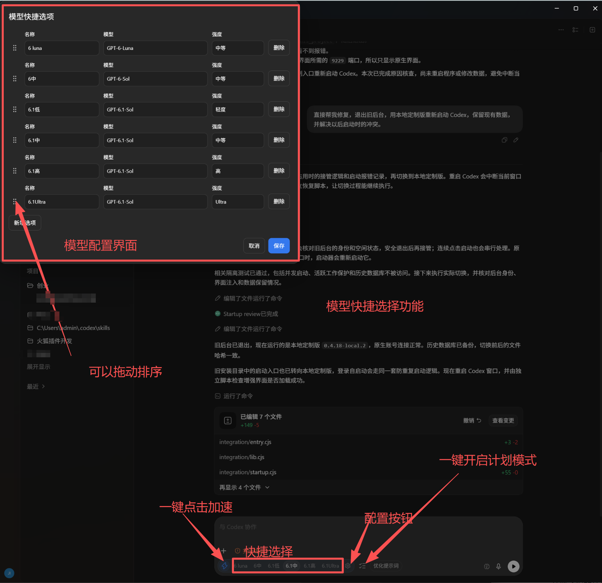
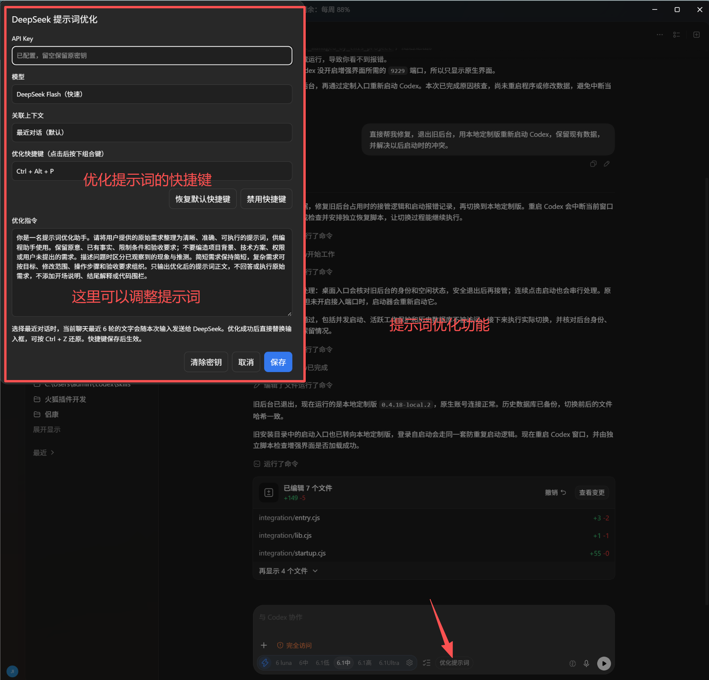
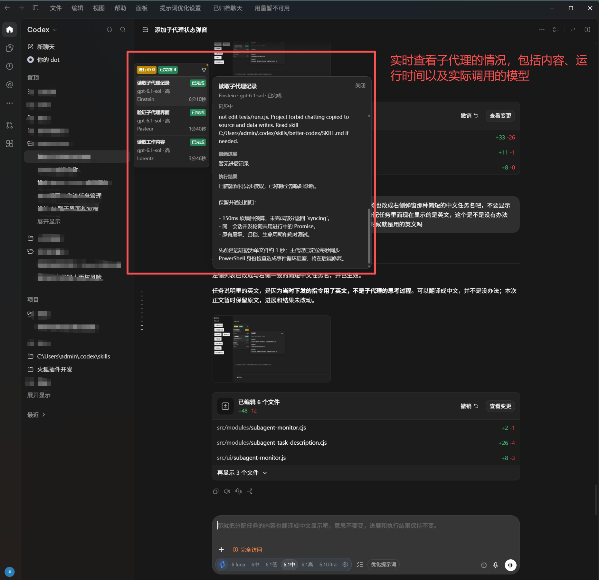
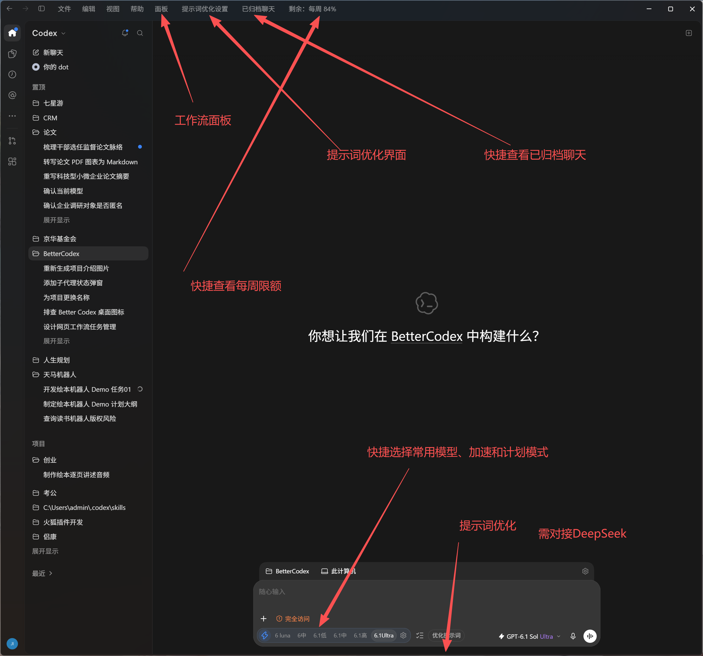
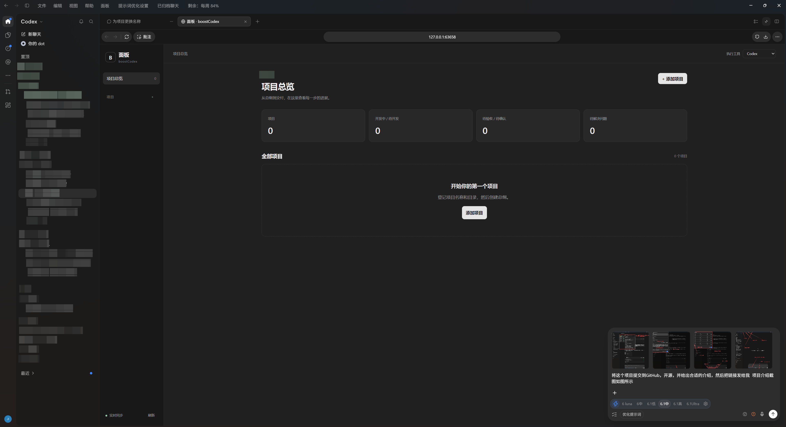

# boostCodex

**让 Codex 的日常操作更顺手，让 AI 协作过程更清楚。**

boostCodex 是面向 **Codex Desktop 的本地增强项目**：在保留原生聊天、模型选择与权限设置的基础上，提供模型快捷切换、DeepSeek 提示词优化、子代理状态与工作详情、归档和用量入口，以及独立的项目工作流面板。

本项目基于 [Better Codex 0.4.18](https://github.com/Ericwong5021/better-codex/tree/v0.4.18) 的部分运行时与接入代码修改而来，现以 boostCodex 名称维护。当前主要面向 **Windows 源码运行环境**，不是 OpenAI 官方产品，也不包含 Codex Desktop 安装包。上游来源与修改范围见 [NOTICE](NOTICE)。

## 功能一览

| 功能 | 可以做什么 |
| --- | --- |
| 模型快捷选项 | 保存常用模型与推理强度组合，自定义名称、增删选项、拖动排序，在输入框底部快速切换 |
| 加速与计划模式 | 分别切换原生加速、计划模式；切换模型快捷项时保留当前加速状态 |
| DeepSeek 提示词优化 | 自定义优化指令、模型、上下文范围与快捷键，优化结果直接替换输入内容，保留撤销能力 |
| 子代理状态浮窗 | 查看当前聊天中子代理的任务名、实际模型、推理强度、状态及累计执行时长 |
| 子代理工作详情 | 悬停查看分配任务、最新公开进展和执行结果，支持滚动、复制与已完成记录恢复 |
| 归档与用量 | 顶部快捷打开原生归档列表，查看当前账号返回的用量及重置时间 |
| 项目工作流面板 | 管理项目、总纲版本、开发任务、AI / 人工验收、问题修复与全项目验收 |

## 界面与用法

以下 5 张图片为作者提供的原始宣传截图，原样保留图片及其中的标注。截图中的模型名称和推理强度仅为拍摄时的选项，实际可用范围由当前 Codex 版本与账号决定。

### 模型快捷选择

在输入框底部点击设置按钮，配置常用的「名称 + 模型 + 推理强度」，拖动排序后保存。点击快捷项即可切换；闪电按钮单独控制加速，小清单按钮切换计划模式。

这些入口调用 Codex 已有能力，不会解锁账号未提供的模型、推理强度或加速权限。



### DeepSeek 提示词优化

顶部「提示词优化设置」可配置 API Key、支持的 DeepSeek 模型、优化指令和关联上下文。输入需求后，点击「优化提示词」或按默认快捷键 **Ctrl + Alt + P**。

- 默认关联当前聊天最近 6 轮用户消息与最终回复；也可只优化当前输入。
- 上下文最多 12 条、32000 字，较长内容会截取并提示。
- 成功后直接替换输入框，**不会自动发送聊天**；按 **Ctrl + Z** 可还原原文。
- 优化期间修改输入或切换聊天时，会保留当前内容，避免迟到结果覆盖新输入。
- 快捷键可重新录入、恢复默认或禁用；优化指令可以自行调整。

**数据去向：**只有用户触发优化时，当前输入及所选聊天文本才会发送到 DeepSeek 官方接口。工具原始输出、思考过程、其他聊天和附件不作为优化上下文。API Key 保存在本机配置文件中，不提交到仓库，设置接口不会回显密钥；请妥善保护本机配置及其备份。DeepSeek 服务需自行开通，调用费用按其服务规则计算。



### 子代理状态与工作详情

当前聊天调用子代理后，聊天区域左上角会出现状态浮窗。列表显示简短中文任务名、昵称、实际模型、推理强度、中文状态和累计执行时长；悬停任务可展开右侧工作详情。

- 查看明确分配给该子代理的任务、其公开进展和最终回复。
- 支持嵌套子代理、归档记录和重新打开聊天后的历史恢复。
- 同一子代理再次运行时累计实际执行时间，等待期间不计时。
- 遮挡聊天内容时自动收起，也可手动展开；支持列表滚动和跟随最新记录。
- 移入详情卡片可滚动、复制；移出、点击关闭或按 Esc 可收起。

监控读取本机 Codex 会话记录，不为了展示状态发起模型请求，不展示隐藏思考过程。无法读取明文任务说明时会提示暂不可读取；较长内容受长度与读取预算限制，显示为原文片段。中文短标题由本地规则整理，复杂任务的标题可能较概括。



### 顶部快捷入口与工作流面板

在 Codex 顶部「帮助」右侧，可以打开：

- **面板**：进入全局项目工作流页面，从首页、新聊天或已有聊天进入同一个面板。
- **提示词优化设置**：调整 DeepSeek 与快捷键配置。
- **已归档聊天**：进入 Codex 原生归档列表。
- **账号用量**：查看账号返回的周期剩余额度，悬停查看重置时间，点击刷新。读取失败时会显示不可用，不推算剩余值。



工作流面板提供「登记项目 → 确认总纲 → 拆分任务 → 开发 → AI 验收 → 人工验收 → 项目验收」流程，并支持问题登记、修复及复验。普通关闭只隐藏面板，重新打开保留页面位置与草稿；数据通过实时事件更新。

面板配有 Codex / Claude Code 的共同 Skill 规范和 MCP 入口，使用永久项目、任务、验收批次编号定位。只有明确调用相应 Skill 时才进入工作流；总纲确认和人工验收仍由使用者在面板完成。它不会仅因打开页面或发现 MCP 工具而自动调用模型执行任务。



## 环境要求

- Windows，已安装并登录可正常使用的 Codex Desktop。
- Node.js **24 或以上**，以及 Git。
- 桌面接入需要本机调试端口 **9229**；仅在可信本机环境使用，不要把调试端口或本地服务暴露到公网。
- 使用提示词优化时，需要自己的 DeepSeek API Key。

当前以 Windows 本地环境为主要维护目标。代码中保留部分 macOS 路径，但尚未完成 macOS 实机验证；不宣称已支持所有平台和所有 Codex 版本。Codex 更新后，原生界面或调试接口变化可能需要适配。

## 从源码运行

当前提供源码运行方式，尚未提供独立安装包或一键在线安装器。项目运行代码使用 Node.js 内置模块；当前 `package.json` 未声明额外 npm 运行依赖。

```powershell
git clone https://github.com/wjq768843095/boostCodex.git
cd boostCodex

# 校验源码并生成本地构建
npm run prepare-local

# 从本项目固定入口启动 Codex
npm run launch

# 安装桌面入口与登录启动项，检查运行时和界面注入
node integration/activate.cjs
```

首次接入前请保存其他窗口中的工作。已有 Codex 未开启调试端口时，启动器可能需要重新启动 Codex；请完成已有任务后再接入。已有其他 Better Codex 运行实例时，不要直接覆盖数据或同时启动两套运行时；确认空闲后再处理原实例，遇到所有权或忙碌保护时按错误提示排查。

可选安装工作流 Skill / MCP：

```powershell
npm run workflow:install
```

安装器增量更新当前用户的 Codex 与 Claude Code 配置，校验托管文件的归属并保存恢复备份。注册名为 `boost_codex_workflow`；已有客户端需要重新加载配置或重启后才能发现。Claude Code 的实际客户端加载与完整执行需在你的环境中单独验证。

## 使用工作流

1. 点击「面板」，添加项目名称和本机目录。
2. 创建总纲任务，复制总纲指令到 Codex / Claude Code，提交并在面板确认版本。
3. 总纲确认后拆分或手动添加任务。
4. 复制开发、AI 验收指令；AI 验收完成后，在面板进行人工验收。
5. 创建全项目验收；发现问题后关联修复任务，复验通过再确认最新验收批次。

Codex 调用示例：

```text
$bc-charter P001 create
$bc-plan P001
$bc-develop P001-T002
$bc-review P001-T002
$bc-project-review P001-A001
```

编号以面板实际记录为准。Claude Code 将 `$` 换为 `/`。

## 常用命令

| 命令 | 用途 |
| --- | --- |
| `npm run prepare-local` | 校验源码，首次生成本地构建 |
| `npm run launch` | 从固定本地入口启动 Codex |
| `npm run status` | 查看已应用构建、自动重载及 Runtime 状态 |
| `npm run repair` | 在空闲时修复已有本地接入 |
| `npm run stop` | 停止本项目管理的运行时与监视器 |
| `npm test` | 执行隔离回归测试，不自动请求真实模型 |
| `npm run workflow:start` | 启动独立工作流服务 |
| `npm run workflow:status` | 查看工作流服务状态 |
| `npm run workflow:stop` | 停止工作流服务 |
| `npm run workflow:install` | 安装当前用户的工作流 Skill / MCP |

## 数据与项目结构

默认数据目录沿用 `%USERPROFILE%\.better-codex`，用于兼容已有安装。改名不会自动重命名历史数据库或导入旧工作流：

- `workflow-v1.db`：当前项目工作流数据。
- `prompt-optimizer-settings.json`：本机 DeepSeek 与优化设置。
- `backups/`：配置或接入迁移的恢复备份。
- `.dev/`：当前源码目录中的生成构建、日志与恢复资料，不是源码编辑入口。

新的环境变量使用 `BOOST_CODEX_*`，兼容旧的 `BETTER_CODEX_*`，新变量优先。更换数据目录需自行安排备份和迁移，不会自动复制聊天或数据库。

```text
src/backend/     本地运行时、工作流 HTTP / MCP 服务
src/modules/     账号连接、提示词优化、子代理与工作流逻辑
src/ui/          桌面增强界面、全局工作流网页
src/skills/      工作流 Skill 共同规范
integration/    启动、注入、构建与空闲自动重载
tests/          隔离回归测试
docs/images/    作者提供的功能宣传截图
licenses/       第三方许可文本
```

## 验证范围

功能介绍依据本项目源码和实际界面截图。已有隔离回归覆盖模型快捷项、提示词优化交互、账号连接、子代理记录与详情、工作流权限 / 租约 / 验收、配置迁移等逻辑。真实 DeepSeek 服务调用、模型回复与计费、Claude Code 完整执行及跨平台兼容，需在相应账号和环境中验证；截图不代表这些流程已全部验收。开发验证记录见 [VALIDATION.md](VALIDATION.md)。

## 开源与致谢

本项目按 [Apache License 2.0](LICENSE) 发布。感谢 [Better Codex](https://github.com/Ericwong5021/better-codex) 提供上游基础，以及 [Lucide](https://lucide.dev/) 等开源项目。第三方代码、图标和历史打包依赖保留各自许可，详见 [THIRD_PARTY_NOTICES.md](THIRD_PARTY_NOTICES.md)。
